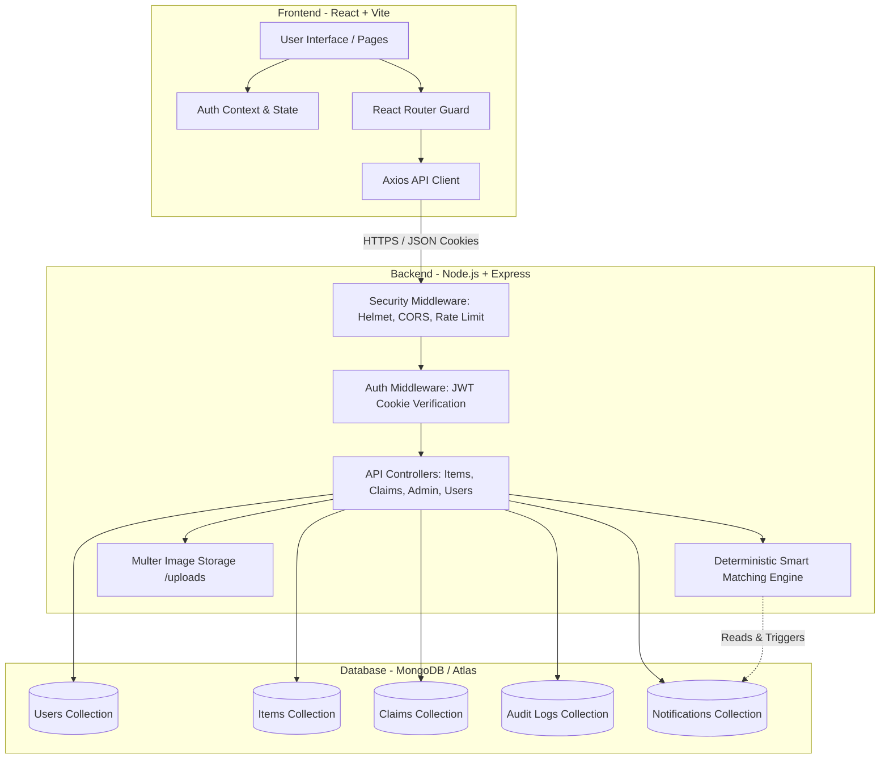
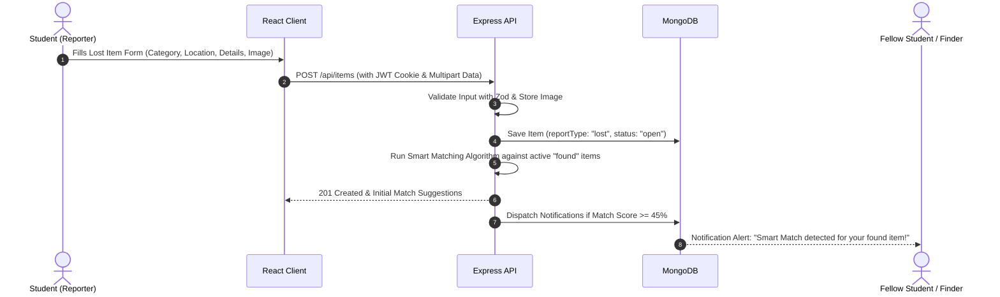
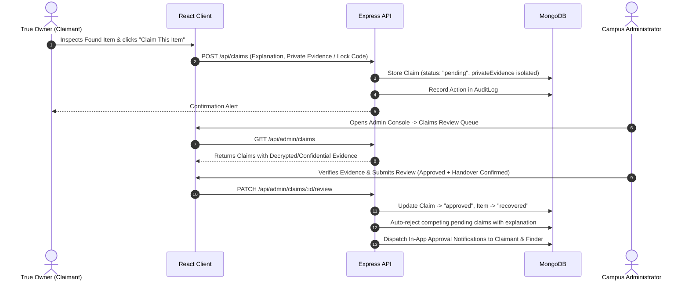
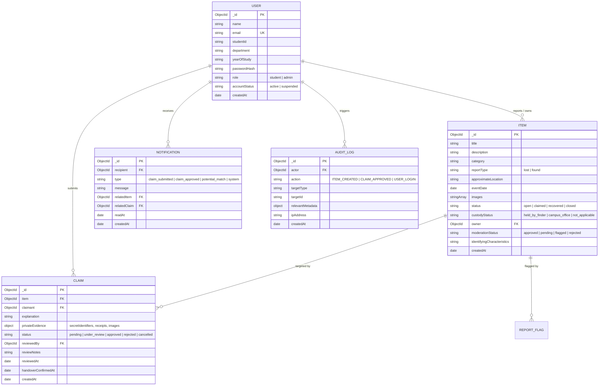

# CampusConnect — Smart Lost & Found Management System

> **B.Tech Computer Science and Engineering — Web Technologies Lab Project**  
> *"Lost Something? Let's Bring It Back."*

---

## 1. Project Title
**CampusConnect: Smart Lost & Found Management System for College Campuses**

---

## 2. Abstract
On modern academic campuses, thousands of students, faculty, and administrative staff circulate daily through lecture halls, laboratories, libraries, auditoriums, sports grounds, and cafeterias. During these daily movements, valuable personal belongings—including college identity cards, mobile electronics, headphones, scientific calculators, notebooks, wallets, and keys—are frequently misplaced. Traditional recovery mechanisms rely on informal, fragmented channels such as unmoderated WhatsApp groups, physical noticeboards, or social media pages, which suffer from zero verification, high susceptibility to false claims, privacy disclosures, and absence of audit records.

**CampusConnect** is a full-stack, database-backed web application engineered to centralize, streamline, and secure the campus lost-and-found lifecycle. The platform features role-based access control (Student vs. Administrator), deterministic smart item matching based on category, location, and date proximity, confidential ownership evidence verification, an in-app notification dispatch engine, and a tamper-evident administrative audit log. Built using the modern MERN architecture (React 18 + Vite, Node.js, Express.js, and MongoDB with Mongoose), CampusConnect provides a complete, production-grade software solution tailored for college environments.

---

## 3. Problem Statement
Existing campus lost-and-found practices present severe operational challenges:
1. **Dispersed Communication:** Reports are scattered across various social media and chat groups without a searchable catalog.
2. **Fraudulent Claims:** Opportunistic claimants can falsely claim valuable items because finders often publish every identifying detail publicly.
3. **Privacy Exposure:** Students often post their private phone numbers, roll numbers, and personal details on public notices, exposing themselves to harassment.
4. **Lack of Accountable Custody:** Items handed to security or department offices lack digitized custody records, resulting in untracked items remaining in storage bins indefinitely.
5. **No Auditability:** No verification records exist to prove who authorized an item return, making dispute resolution difficult.

---

## 4. Objectives
- **Centralized Platform:** Establish a unified, accessible portal for reporting lost belongings and publishing found items across all campus zones.
- **Confidential Ownership Verification:** Protect item details so that true owners must submit private, verifiable evidence (such as lock screen codes, specific scratches, or serial/invoice numbers) before approval.
- **Deterministic Smart Matching:** Compute similarity scores between lost and found reports using keyword tokenization, category matching, and campus vicinity to alert matching parties.
- **Administrative Moderation & Custody Management:** Provide campus administrators with a real-time dashboard to review claims, track custody status ("Held by finder" vs. "Handed to Campus Office"), and moderate inappropriate content.
- **Security & Privacy by Design:** Implement secure authentication using HTTP-only JWT cookies, bcrypt password hashing, input sanitization, rate limiting, and role authorization middleware.

---

## 5. Existing System vs. Proposed System

| Dimension | Existing Manual / Chat Methods | Proposed CampusConnect System |
| :--- | :--- | :--- |
| **Storage & Discovery** | Fragmented chat groups, paper notices | Centralized MongoDB database with multi-field text search & filtering |
| **Ownership Proof** | Casual verbal agreement or text screenshot | Structured, confidential private evidence review workflow |
| **Security & Privacy** | Public phone numbers & roll numbers exposed | Contact details sanitized; secure HTTP-only cookies; zero plain-text passwords |
| **Item Matching** | Manual, luck-dependent reading of chat history | Automated deterministic matching engine with in-app notification alerts |
| **Accountability** | Zero audit logs or verification timestamps | Append-only security audit log recording every report, claim, and review |
| **Custody Status** | Unknown where item is physically located | Explicit custody tracking ("Held by Finder" vs. "Office Room 104") |

---

## 6. Scope
- **Target Audience:** College students, faculty members, lab assistants, security staff, and campus administration.
- **Functional Scope:** User registration with college email validation, authenticated session management, CRUD operations for lost/found reports, multi-criteria discovery filters, smart matching notifications, ownership claims review, administrative moderation, and student dashboard analytics.
- **Deployment Scope:** Ready for local development with zero-setup in-memory database fallback, Docker containerization, or cloud deployment on Render/Railway (backend) and Vercel/Netlify (frontend) with MongoDB Atlas.

---

## 7. Software and Hardware Requirements

### Software Requirements
- **Operating System:** Windows 10/11, macOS, or Linux
- **Runtime Environment:** Node.js (v18.0.0 or higher) & npm (v9.0.0 or higher)
- **Database:** MongoDB Community Server (v6.0+) or MongoDB Atlas (Free M0 Tier), with automatic `mongodb-memory-server` fallback for zero-configuration testing.
- **Browser:** Google Chrome, Mozilla Firefox, Microsoft Edge, or Safari with JavaScript enabled.
- **Development Tools:** VS Code, Git, Postman / REST Client.

### Hardware Requirements
- **Processor:** Dual-core 2.0 GHz or higher (x86_64 or Apple Silicon)
- **RAM:** Minimum 4 GB (8 GB recommended for concurrent development)
- **Disk Space:** At least 500 MB free space for dependencies, build assets, and uploaded images.

---

## 8. Technology Stack

### Frontend
- **HTML5 & CSS3:** Semantic markup, custom CSS variables for cohesive design systems, light/dark themes.
- **React 18 & Vite:** Lightning-fast HMR build tooling, component-driven UI architecture, custom hooks, and React Context.
- **React Router DOM (v6):** Client-side declarative routing, URL query synchronization, and route guards (`ProtectedRoute`, `AdminRoute`).
- **Lucide React:** Consistent iconography for categories, statuses, and navigation.
- **Recharts:** Responsive SVG data visualization for administrator analytics and item breakdowns.
- **Axios:** Central HTTP client with credential handling and response interceptors.

### Backend
- **Node.js & Express.js:** Event-driven, non-blocking asynchronous server runtime with RESTful API architecture.
- **JWT (JSON Web Tokens):** Stateless token-based authentication delivered via HTTP-only, SameSite cookies.
- **bcryptjs:** Salted password hashing (10 salt rounds) safeguarding against rainbow table attacks.
- **Zod:** Strict runtime schema validation for registration, item submission, and claim reviews.
- **Helmet:** Security middleware setting HTTP response headers (CSP, frameguard, XSS protection).
- **express-rate-limit:** IP rate-limiting guarding authentication endpoints against brute-force attacks.
- **Multer:** Secure multi-part file upload processing with MIME type validation (JPEG/PNG/WebP) and 5MB size caps.

### Database
- **MongoDB:** NoSQL document database providing dynamic schemas, compound text indexing, and high-performance querying.
- **Mongoose ODM:** Strongly typed schema definitions, pre/post middleware hooks, and automated timestamps.

---

## 9. System Architecture



---

## 10. Core Workflows

### A. Lost-Item Reporting & Smart Matching Workflow


### B. Ownership Claim & Handover Verification Workflow


---

## 11. Database Schema Design (Entity-Relationship)



---

## 12. RESTful API Documentation

| Method | Endpoint | Description | Access Control |
| :--- | :--- | :--- | :--- |
| **POST** | `/api/auth/register` | Register new student account with validation | Public |
| **POST** | `/api/auth/login` | Authenticate with email/password; sets HTTP-only cookie | Public |
| **POST** | `/api/auth/google-login` | Authenticate via Firebase Google Sign-In (`<rollnumber>@sreyas.ac.in` only) | Public |
| **POST** | `/api/auth/logout` | Clears authentication cookie | Authenticated |
| **GET** | `/api/auth/me` | Fetch currently logged in user profile & unread count | Authenticated |
| **GET** | `/api/items` | Search, filter, paginate, and sort lost & found reports | Public |
| **GET** | `/api/items/:id` | Retrieve single item details & potential matches | Public / Auth |
| **POST** | `/api/items` | Submit new lost or found report with image upload | Authenticated |
| **PATCH**| `/api/items/:id` | Update existing item report | Owner / Admin |
| **DELETE**| `/api/items/:id`| Remove item report | Owner / Admin |
| **PATCH**| `/api/items/:id/recovered` | Mark item as recovered | Owner / Admin |
| **POST** | `/api/items/:id/flag` | Report inappropriate or fake listing | Authenticated |
| **GET** | `/api/items/stats` | Fetch real aggregated platform statistics | Public |
| **GET** | `/api/items/recent` | Fetch latest 6 approved reports for landing page | Public |
| **POST** | `/api/claims` | Submit ownership claim with confidential evidence | Authenticated |
| **GET** | `/api/claims/my` | View claims filed by current user | Authenticated |
| **GET** | `/api/claims/:id` | View specific claim (evidence restricted to reviewer) | Claimant / Admin |
| **PATCH**| `/api/claims/:id/cancel` | Cancel an active pending claim | Claimant |
| **GET** | `/api/notifications` | Fetch user notifications and unread badge count | Authenticated |
| **PATCH**| `/api/notifications/:id/read` | Mark single notification as read | Authenticated |
| **PATCH**| `/api/notifications/read-all` | Mark all notifications as read | Authenticated |
| **GET** | `/api/users/me` | Fetch student profile and personal stats | Authenticated |
| **PATCH**| `/api/users/me` | Update student profile settings | Authenticated |
| **GET** | `/api/users/my-reports` | List reports owned by logged-in student | Authenticated |
| **GET** | `/api/users/saved-items` | Retrieve bookmarked items | Authenticated |
| **POST** | `/api/users/saved-items/:itemId`| Toggle bookmark on an item | Authenticated |
| **GET** | `/api/admin/stats` | Fetch administration metrics and recent audit events | Admin Only |
| **GET** | `/api/admin/users` | List all registered users with search and filter | Admin Only |
| **PATCH**| `/api/admin/users/:id/status` | Suspend or reactivate user account | Admin Only |
| **GET** | `/api/admin/items` | List all items with moderation statuses | Admin Only |
| **PATCH**| `/api/admin/items/:id/moderation` | Approve or reject reported item | Admin Only |
| **GET** | `/api/admin/claims` | View claim review queue with confidential evidence | Admin Only |
| **PATCH**| `/api/admin/claims/:id/review` | Approve/Reject claim and confirm handover | Admin Only |
| **GET** | `/api/admin/flags` | View flagged spam/violation reports | Admin Only |
| **PATCH**| `/api/admin/flags/:id` | Resolve or dismiss flag | Admin Only |
| **GET** | `/api/admin/audit-logs` | Retrieve chronological security audit trail | Admin Only |
| **GET** | `/api/categories` | Retrieve active categories list | Public |
| **GET** | `/api/locations` | Retrieve campus locations list | Public |
| **POST** | `/api/contact` | Submit validated inquiry to lost & found desk | Public |
| **GET** | `/api/health` | System health check and uptime monitor | Public |

---

## 13. Installation and Execution Steps

### Step 1: Clone or Navigate to the Project Directory
```powershell
cd "C:\Users\akshi\OneDrive\Desktop\web tech project(CAMPUS LOST AND FOUND)"
```

### Step 2: Install Dependencies
Install all root, backend, and frontend packages with a single command:
```powershell
npm run install:all
```
*(Or install manually: `npm install`, `cd server && npm install`, `cd ../client && npm install`)*

### Step 3: Configure Environment Variables
- In `server/`, verify `.env` (pre-configured with local defaults).
- In `client/`, verify `.env` (`VITE_API_BASE_URL=/api`).
> **Zero-Setup Database:** If a local MongoDB instance is not running on port 27017, the server will **automatically** start an in-memory MongoDB instance (`mongodb-memory-server`), ensuring zero manual configuration is required for evaluation!

### Step 4: Seed Development & Viva Sample Data
Populate realistic campus records, categories, locations, users, and audit logs:
```powershell
npm run seed
```

### Step 5: Start the Development Server
Launch both the Express backend and React Vite frontend concurrently:
```powershell
npm run dev
```
- **Frontend URL:** [http://localhost:5173](http://localhost:5173)
- **Backend API:** [http://localhost:5000/api](http://localhost:5000/api)
- **Health Endpoint:** [http://localhost:5000/api/health](http://localhost:5000/api/health)

---

## 14. Demo Accounts for Evaluation & Viva

The database seed script initializes ready-to-test accounts:

| Role | Email | Password | Student ID / Department | Notes |
| :--- | :--- | :--- | :--- | :--- |
| **Administrator** | `admin@campusconnect.edu.in` | `Admin@Campus2026!` | `ADMIN-001` (CSE) | Full admin console access, claim verification, moderation |
| **Student 1** | `rahul.sharma@campusconnect.edu.in` | `Student@1234` | `22CS1045` (3rd Yr CSE) | Reported Lost ID Card; filed claim for found Headphones |
| **Student 2** | `priya.patel@campusconnect.edu.in` | `Student@1234` | `23EC2018` (2nd Yr ECE) | Reported Found Headphones; reported lost Calculator |
| **Student 3** | `ananya.sen@campusconnect.edu.in` | `Student@1234` | `21ME3012` (4th Yr ME) | Recovered Laptop Charger; reported lost Wallet |

> **Pro Tip:** On the Login page (`/login`), click the **"Student Demo"** or **"Admin Demo"** buttons to auto-populate credentials for quick demonstration!

---

## 15. Automated Testing Results

The project includes an automated test suite verifying all critical workflows:

Execute the tests:
```powershell
npm run test
```

### Test Execution Summary (19/19 Tests Passed):
```
======================================================
🧪 RUNNING CAMPUSCONNECT AUTOMATED TEST SUITE
======================================================

[Suite 1: System & Health]
  ✅ PASS: Health check endpoint returns 200 OK

[Suite 2: Authentication & Validation]
  ✅ PASS: Registration rejects invalid email and short name (400)
  ✅ PASS: Successful student registration returns 201 Created
  ✅ PASS: User response does not expose passwordHash
  ✅ PASS: Duplicate email registration returns 409 Conflict
  ✅ PASS: Login fails with incorrect password (401)
  ✅ PASS: Login succeeds and returns JWT token

[Suite 3: Role Authorization]
  ✅ PASS: Regular student is denied access to admin stats (403)
  ✅ PASS: Administrator can access admin stats (200)

[Suite 4: Items & Search]
  ✅ PASS: Student can report a lost item (201)
  ✅ PASS: User can report a found item (201)
  ✅ PASS: Search and category filter returns matching items

[Suite 5: Ownership Claims & Verification]
  ✅ PASS: Reporter cannot claim their own found item report (400)
  ✅ PASS: Student can submit ownership claim with private evidence (201)
  ✅ PASS: Duplicate active claim for same item is prevented (409)
  ✅ PASS: Admin can review and approve claim (200)
  ✅ PASS: Approved claim with handover marks item as recovered

[Suite 6: Notifications & Audit]
  ✅ PASS: Student receives in-app notifications for claim updates
  ✅ PASS: Audit trail records all critical platform actions

======================================================
TEST RESULTS: 19 PASSED, 0 FAILED
======================================================
```

---

## 16. Web Technologies Viva Examination Guide

Here are concise explanations of the core Web Technologies concepts implemented in CampusConnect:

1. **HTML5 Semantic Structure:**
   Instead of generic `<div>` tags everywhere, the application utilizes `<header>`, `<nav>`, `<main>`, `<section>`, `<aside>`, `<article>`, and `<footer>` to improve accessibility, maintainability, and SEO parsing.

2. **CSS3 Variables & Design System:**
   CSS Custom Properties (`--bg-primary`, `--accent`, `--border`, etc.) are declared at `:root` and toggled via `[data-theme='dark']`. This enables instant, flash-free light/dark mode transitions without rewriting CSS rules.

3. **Client-Side SPA Architecture (React + Vite):**
   Vite pre-bundles dependencies with esbuild and serves native ES modules over HTTP, providing near-instant hot module replacement (HMR). React maintains an in-memory Virtual DOM, re-rendering only modified components rather than reloading full pages.

4. **RESTful Architecture:**
   The backend adheres to REST conventions: resources are nouns (`/api/items`, `/api/claims`), HTTP methods represent actions (`GET` to read, `POST` to create, `PATCH` to partially update, `DELETE` to remove), and consistent JSON payloads are returned alongside standard HTTP status codes (`200 OK`, `201 Created`, `400 Bad Request`, `401 Unauthorized`, `403 Forbidden`, `404 Not Found`, `409 Conflict`).

5. **JWT & HTTP-Only Cookie Security:**
   Rather than storing tokens in `localStorage` (which is vulnerable to Cross-Site Scripting / XSS attacks), JWT tokens are set inside HTTP-only, SameSite cookies. The browser automatically includes these cookies on subsequent requests, and JavaScript cannot read them directly.

6. **Password Hashing (bcrypt):**
   Passwords are never stored in plain text. A salt (random cryptographic bytes) is combined with the password and hashed through key-stretching iterations, rendering rainbow table and brute-force attacks computationally infeasible.

7. **Database Indexing:**
   MongoDB compound text indexes (`title`, `description`, `approximateLocation`, `category`) enable fast keyword matching across large collections without performing slow full-collection scans.

---

## 17. Limitations
- **Image Storage in Local Environment:** Uploaded images are stored on the local file system in development (`server/uploads`). In large-scale production, this should be delegated to an object store like AWS S3 or Cloudinary.
- **Campus Geo-Fencing:** The current system relies on text-based campus location selections rather than real-time GPS coordinates or interactive campus map boundaries.

---

## 18. Future Enhancements
- **QR Code Campus Badges:** Generate printable QR code tags for student ID cards or laptop covers that allow finders to quickly alert the owner with a single smartphone scan.
- **OCR Text Extraction on Images:** Automatically read text on photos of student ID cards or book covers to auto-fill title, name, and roll number fields.
- **Push & WhatsApp Notification Webhooks:** Integrate Twilio or WhatsApp Business API to send instant SMS/WhatsApp alerts when an approved claim is ready for collection at the campus desk.

---

## 19. Conclusion
**CampusConnect** successfully bridges the gap between campus honesty, technological verification, and student security. By replacing informal chat groups with an authenticated, database-backed platform featuring confidential claim verification, deterministic smart matching, and comprehensive administrative oversight, CampusConnect delivers an exemplary, production-quality Web Technologies project ready for academic evaluation, viva demonstration, and campus adoption.
